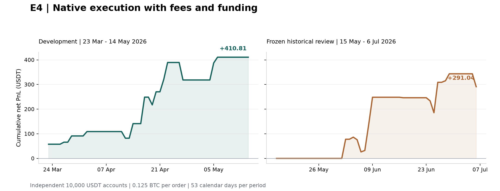

# HFT Market Microstructure Research

**BTCUSDT 永续合约的高频特征、费用后预测与原生交易仿真。**

C++20 · Python · Polars · XGBoost · CMake · hftbacktest-cpp

项目从逐笔成交与历史盘口出发，构建100ms Features、1s Factors和独立预测标签，研究短期价格信息如何转化为交易决策。订单簿、事件调度、委托生命周期和成交模拟复用固定版本的开源回测引擎。

[**阅读 E4 交互报告 →**](https://qiye3.github.io/hft_mm_research/)
[完整过程与公式](docs/reports/e4_20261115/report.md) · [实验结果目录](docs/reports/README.md) · [代码阅读指南](docs/reading_guide.md)

## 代表研究 · E4

E4在原180列输入上增加12列训练期筛选的长周期微观结构因子，以多空两个XGBoost模型预测1800秒费用后获利概率。经过持有期、风险退出及仓位对照，再以0.125 BTC固定委托进行真实L2原生Maker回放。

| 原生账户指标 | 开发期 | 冻结历史复核 |
| --- | ---: | ---: |
| 日期 | 2026-03-23—05-14 | 2026-05-15—07-06 |
| 完整日历 | 53日 | 53日 |
| 初始本金 | 10,000 USDT | 10,000 USDT |
| 费用后净收益 | +410.81 USDT | +291.04 USDT |
| 53日复合年化 | 31.95% | 21.84% |
| 最大回撤 | 1.82% | 2.39% |
| 峰值总敞口 | 0.9804倍 | 0.8802倍 |
| 往返交易 | 22 | 26 |
| 剔除最好一周后净收益 | +238.70 USDT | +74.97 USDT |



费用包括实际模拟Maker/Taker成交手续费及资金费。年化按完整53日折算，无成交日纳入分母。复核年化未达到预设30%门槛，收益主要集中在6月。该区间曾由其他实验查看，作为冻结历史复核报告。Python生成冻结预测，C++逐事件执行订单与风控。[完整结果及来源](docs/reports/e4_20261115/report.md)

## 研究链路

```text
普通逐笔成交 + 历史盘口快照
  → 标准 Parquet
  → 100ms Features
  → 1s Factors + 独立 Targets
  → 同样本评价、训练期选列与模型比较
  → 冻结预测、策略与风险规则
  → 真实 L2 + 官方成交的 C++ 原生回放
  → 订单 / 成交 / 费用 / 资金费 / 账户权益
```

- **数据与特征** — 标准研究行情覆盖2025-05-09至2026-10-21，共531天。研究可见时钟采用交易所时间加20ms，缺失和来源切换显式标记。
- **因子与目标** — Polars负责探索性构造，按真实秒数滚动、跨午夜延续。每个Feature/Factor一份全日期Parquet，Targets独立版本管理。
- **模型与评价** — 线性基线、树、MLP与序列模型按实验组比较。特征选择和预处理使用训练期，开发选参后冻结历史复核。
- **策略与执行** — 固定报价、预测驱动入场、库存限制、风险退出和Maker优先执行。原生引擎管理排队、延迟、在途请求和部分成交，独立账本核对权益。

## Quickstart

### 安装与构建

需要Git、C++20编译器、Python 3.12+、zlib和[uv](https://docs.astral.sh/uv/)。macOS使用Xcode Command Line Tools，Linux使用对应编译器及zlib开发包。

```sh
git clone --recurse-submodules https://github.com/qiye3/hft_mm_research.git
cd hft_mm_research
uv venv .venv
uv pip install --python .venv/bin/python -r requirements.txt
. .venv/bin/activate
cmake -S . -B workspace/build/release -G Ninja \
  -DCMAKE_BUILD_TYPE=Release \
  -DPython3_EXECUTABLE="$PWD/.venv/bin/python"
cmake --build workspace/build/release --parallel 4
```

第三方引擎通过Submodule固定到`e0d2f7887c68755b220d9e69425d61d27e5b6432`。已有检出可运行`git submodule update --init --recursive`。

### 用合成行情验证回放

```sh
ctest --test-dir workspace/build/release --output-on-failure
./workspace/build/release/replay_probe config/replay/synthetic.yaml
```

合成报告保存到`workspace/results/synthetic/replay.json`。该入口可独立验证事件调度、盘口状态和观察统计。

### 运行研究数据生产

准备好配置明确声明的原始行情后，在项目根执行。

```sh
python scripts/build_standard_data.py config/data/standardize_30d.yaml
python scripts/build_features.py config/features/build_30d.yaml
python scripts/build_labels.py config/targets/build_1s.yaml
POLARS_MAX_THREADS=5 python scripts/build_factors.py config/factors/all_non_ofi.yaml
POLARS_MAX_THREADS=2 python scripts/evaluate_factors.py config/evaluation/all_non_ofi.yaml
```

各YAML声明自己的输入、输出、日期和版本。真实研究需要自行准备标准行情，配置日期按实际取得的数据调整。全量531日、跨市场与GPU模型实验的资源需求高于合成回放。[数据来源与准备](docs/implementation/data_requirements.md) · [研究包输入输出](docs/implementation/research_package.md) · [E4复现命令](docs/reports/e4_20261115/report.md#103-复现命令)

## 代码导航

| 位置 | 职责 | 推荐入口 |
| --- | --- | --- |
| `src/` | C++回放、报价、风控与账本 | [execution_policy.cpp](src/mm/strategies/execution_policy.cpp) |
| `research/mm_research/data/` | 原始行情标准化与存储 | [standard.py](research/mm_research/data/standard.py) |
| `research/mm_research/features/` | 100ms基础及衍生特征 | [base.py](research/mm_research/features/base.py) |
| `research/mm_research/factors/` | 分族因子公式 | [gen041.py](research/mm_research/factors/gen041.py) |
| `research/mm_research/targets/` | 独立预测标签 | [midprice.py](research/mm_research/targets/midprice.py) |
| `research/mm_research/models/` | 选列、训练与校准 | [cost_classifier.py](research/mm_research/models/cost_classifier.py) |
| `research/mm_research/strategies/` | 实验规则与原生接入 | [cost_native.py](research/mm_research/strategies/cost_native.py) |
| `research/mm_research/evaluation/` | 因子、模型及交易诊断 | [fee_models.py](research/mm_research/evaluation/fee_models.py) |
| `config/` | 按阶段组织的显式配置 | [E4模型配置](config/models/cost_gen041_e4_20261114.yaml) |
| `scripts/` | 命令行入口与任务编排 | [run_cost_native.py](scripts/run_cost_native.py) |
| `tests/` | 公式、边界、订单与账本测试 | [研究规范](AGENTS.md) |
| `apps/factorboard/` | 因子交互研究与管理 | [FactorBoard说明](apps/factorboard/README.md) |
| `docs/` | 方法、实现与实验报告 | [文档目录](docs/README.md) |
| `workspace/` | 本地数据、构建与运行产物 | 由Git忽略 |

## 深入阅读

[引擎与双时间戳](docs/implementation/engine_notes.md) · [委托、库存与账本](docs/implementation/m1_notes.md) · [夜间资源控制](docs/implementation/overnight_research.md) · [M0整日性能](docs/reports/m0_2025-02-01/report.md) · [仓库敏感信息约定](SECURITY.md)
