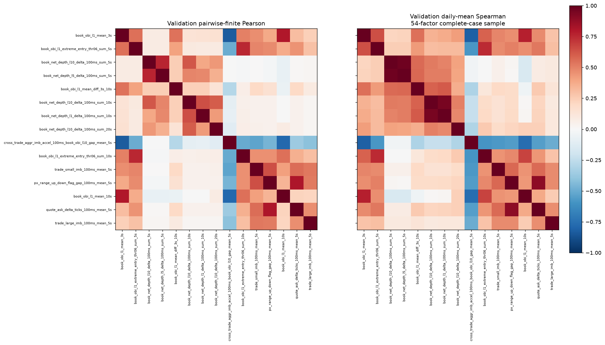

# 候选因子筛选与相关性分析

本轮评测因子 876 个，通过单因子门槛 362 个，相关性代表池 54 个，最终保留 15 个。

## 筛选范围与门槛

主目标为未来1秒Mid变化。方向只由训练期日均IC确定，所有门槛和排序使用训练期、验证期。训练截至2026-05-31，验证为2026-06-01至2026-08-31。
训练与验证的共同覆盖率均至少90%，有效IC日期至少90%，训练绝对IC至少0.01、定向验证IC至少0.005，两个区段的Rank IC方向均一致。定向正IC日占比均至少60%。训练正向月份至少75%，验证全部有效月份同向。来源切换2025-10-01之前和之后的训练日均IC也要求方向一致。
排序分数为定向训练IC与验证IC的较小值。相关性池合并全局前20、每个通过门槛组的前2，以及前5个公式族的前3个窗口。通过门槛但未进入池的因子保留在screening.parquet，后续可扩展分析。

## 相关性与样本

读取候选池全部训练、验证日期的整秒原始取值，并在区段末尾剔除300秒。用于去重的Pearson对每一对因子分别取共同有限样本，保留逐对样本数。相关性样本只要求因子取值有效，未要求标签有效，未填补缺失。Spearman采用整个候选池共同有限样本、每日平均秩，再对有效日期等权，仅作为诊断对照。各矩阵保留原始符号。
抽查2025-11-14发现，54个候选中53个覆盖率超过95%，25k显示执行成本因子仅58.7%。因此增加逐对Pearson口径，防止该条件性因子的缺失缩小其他组合的样本。
最终候选按上述分数依次加入，训练或验证逐对Pearson的绝对相关性达到0.85即视为重复，最多保留15个。此轮单因子门槛和验证期参与了选择，结果属于候选筛选。

以下全池共同样本量对应Spearman对照口径。

| 区间 | 实际共同样本 | 边界处理后网格 | 覆盖率 | 天数 |
| --- | ---: | ---: | ---: | ---: |
| 训练 | 29,220,750 | 33,522,900 | 87.17% | 388 |
| 验证 | 6,976,350 | 7,948,500 | 87.77% | 92 |

逐对Pearson的有效样本覆盖如下。

| 区间 | 逐对覆盖率最低 | 逐对覆盖率中位数 | 逐对覆盖率最高 |
| --- | ---: | ---: | ---: |
| 训练 | 88.21% | 99.23% | 100.00% |
| 验证 | 88.85% | 99.63% | 100.00% |

## 最终候选

| 因子 | 组别 | 使用方向 | 训练IC | 验证IC | 验证Rank IC | 训练覆盖 | 验证覆盖 |
| --- | --- | ---: | ---: | ---: | ---: | ---: | ---: |
| book_obi_l1_mean_3s | gen001 | +1 | 0.1334 | 0.1140 | 0.1988 | 99.11% | 99.62% |
| book_obi_l1_extreme_entry_thr06_sum_5s | gen019 | +1 | 0.1170 | 0.1031 | 0.1767 | 99.02% | 99.61% |
| book_net_depth_l10_delta_100ms_sum_5s | gen006 | +1 | 0.1377 | 0.1004 | 0.2086 | 99.02% | 99.61% |
| book_net_depth_l5_delta_100ms_sum_5s | gen006 | +1 | 0.1358 | 0.0994 | 0.2101 | 99.02% | 99.61% |
| book_obi_l1_mean_diff_3s_10s | gen002 | +1 | 0.1124 | 0.0988 | 0.1536 | 98.90% | 99.61% |
| book_net_depth_l10_delta_100ms_sum_10s | gen006 | +1 | 0.1340 | 0.0969 | 0.2146 | 99.00% | 99.61% |
| book_net_depth_l1_delta_100ms_sum_10s | gen006 | +1 | 0.1257 | 0.0926 | 0.2157 | 99.00% | 99.61% |
| book_net_depth_l10_delta_100ms_sum_20s | gen006 | +1 | 0.1282 | 0.0904 | 0.2144 | 99.06% | 99.60% |
| cross_trade_aggr_imb_accel_100ms_book_obi_l10_gap_mean_5s | gen009 | -1 | -0.0963 | -0.0830 | -0.1519 | 99.06% | 99.62% |
| book_obi_l1_extreme_entry_thr06_sum_10s | gen019 | +1 | 0.0896 | 0.0781 | 0.1426 | 98.99% | 99.61% |
| trade_small_imb_100ms_mean_5s | gen010 | +1 | 0.0866 | 0.0702 | 0.1261 | 99.37% | 99.63% |
| px_range_up_down_flag_gap_100ms_mean_5s | gen028 | +1 | 0.0786 | 0.0665 | 0.1305 | 98.76% | 99.60% |
| book_obi_l1_mean_10s | gen001 | +1 | 0.0775 | 0.0656 | 0.1272 | 99.04% | 99.61% |
| quote_ask_delta_ticks_100ms_mean_5s | gen015 | +1 | 0.0785 | 0.0631 | 0.1353 | 99.02% | 99.61% |
| trade_large_imb_100ms_mean_5s | gen010 | +1 | 0.0661 | 0.0540 | 0.0938 | 99.37% | 99.63% |

使用方向为-1时，将原始因子乘以-1后解释为正向信号。方向由训练期固定。

## 候选结构与备选

默认名单覆盖8个因子组。净深度变化等同族因子仍有多个窗口进入名单，0.85阈值允许保留中度相关的变量。以下为各组进入默认名单的数量。

| 因子组 | 入选数 |
| --- | ---: |
| gen006 | 5 |
| gen019 | 2 |
| gen010 | 2 |
| gen001 | 2 |
| gen015 | 1 |
| gen002 | 1 |
| gen028 | 1 |
| gen009 | 1 |

相关性池中另有19个与更高排序的已选因子达到相关阈值，20个通过当前相关门槛但受15个名额上限保留为备选。以下展示备选前六，完整名单见candidates.csv。

| 备选因子 | 组别 | 训练IC | 验证IC |
| --- | --- | ---: | ---: |
| px_ask_transition_signed_100ms_mean_5s | gen032 | 0.0682 | 0.0535 |
| px_bid_transition_signed_100ms_mean_5s | gen032 | 0.0685 | 0.0535 |
| px_range_down_flag_100ms_mean_5s | gen028 | -0.0599 | -0.0506 |
| px_ret_100ms_sum_10s | gen005 | 0.0596 | 0.0493 |
| book_obi_l1_extreme_entry_thr06_sum_30s | gen019 | 0.0520 | 0.0449 |
| book_obi_l5_extreme_entry_thr06_sum_30s | gen019 | 0.0515 | 0.0438 |

## 相关性最高的组合

Pearson使用逐对有效样本，Spearman使用全池共同样本。

| 左因子 | 右因子 | 训练Pearson | 验证Pearson | 训练日均Spearman | 验证日均Spearman |
| --- | --- | ---: | ---: | ---: | ---: |
| quote_ask_delta_ticks_100ms_mean_5s | quote_bid_delta_ticks_100ms_mean_5s | 0.9993 | 0.9999 | 0.9997 | 0.9999 |
| trade_net_notional_100ms_sum_5s | trade_net_qty_100ms_sum_5s | 0.9804 | 0.9964 | 1.0000 | 1.0000 |
| quote_ask_delta_ticks_100ms_mean_5s | px_ret_100ms_sum_5s | 0.9796 | 0.9947 | 0.9978 | 0.9980 |
| quote_bid_delta_ticks_100ms_mean_5s | px_ret_100ms_sum_5s | 0.9796 | 0.9947 | 0.9978 | 0.9980 |
| book_obi_l5_mean_10s | book_obi_l10_mean_10s | 0.9945 | 0.9895 | 0.9932 | 0.9881 |
| book_obi_l5_mean_5s | book_obi_l10_mean_5s | 0.9944 | 0.9895 | 0.9933 | 0.9883 |
| book_obi_l5_mean_3s | book_obi_l10_mean_3s | 0.9943 | 0.9895 | 0.9933 | 0.9883 |
| book_obi_l5_mean_diff_3s_10s | book_obi_l10_mean_diff_3s_10s | 0.9940 | 0.9895 | 0.9915 | 0.9842 |
| book_obi_l1_mean_diff_3s_10s | book_obi_l5_mean_diff_3s_10s | 0.9931 | 0.9897 | 0.9906 | 0.9849 |
| cross_trade_aggr_imb_accel_100ms_book_obi_l10_gap_mean_5s | cross_trade_aggr_imb_accel_100ms_book_obi_l1_gap_mean_5s | 0.9927 | 0.9880 | 0.9911 | 0.9862 |
| px_ask_transition_signed_100ms_mean_5s | px_bid_transition_signed_100ms_mean_5s | 0.9717 | 0.9926 | 0.9756 | 0.9901 |
| book_obi_l1_mean_3s | book_obi_l5_mean_3s | 0.9926 | 0.9886 | 0.9915 | 0.9874 |

## 阈值敏感性

三档均保留最多15个，所以需要同时比较成员与组别变化。

| 绝对相关阈值 | 保留数 | 因子组数 | 与默认0.85名单重合数 |
| --- | ---: | ---: | ---: |
| 0.7 | 15 | 10 | 9 |
| 0.85 | 15 | 8 | 15 |
| 0.95 | 15 | 6 | 9 |

## 筛选损耗

同一个因子可能触发多条条件，以下数量允许重叠。

| 原因 | 因子数 |
| --- | ---: |
| 训练绝对IC不足0.01 | 477 |
| 定向验证IC不足0.005 | 446 |
| 训练定向正IC日不足60% | 364 |
| 验证定向正IC日不足60% | 362 |
| 验证月份未全部同向 | 355 |
| 训练同向月份不足75% | 276 |
| 验证Rank IC方向不一致 | 268 |
| 训练Rank IC方向不一致 | 231 |
| 来源切换后训练IC方向不一致 | 113 |
| 验证覆盖不足90% | 92 |
| 训练覆盖不足90% | 85 |
| 来源切换前训练IC方向不一致 | 75 |
| 验证有效IC日不足90% | 17 |
| 训练有效IC日不足90% | 8 |

## 产物与复现

screening.parquet保存全部因子门槛及是否进入相关性池。candidates.csv记录池内因子去留与替代对象。correlation_pairs.parquet保存逐对Pearson、全池共同样本Pearson、日均Spearman和逐对样本数。daily_correlations.parquet保存全池共同样本上的逐日统计。run.json保存固定门槛、输入位置、覆盖率和阈值敏感性。



服务器复现命令如下，输出目录必须是新目录。

```bash
cd /root/shared-nvme/hft_mm_research
PYTHONPATH=research POLARS_MAX_THREADS=2 OPENBLAS_NUM_THREADS=1 OMP_NUM_THREADS=1 .venv/bin/python workspace/results/candidate_selection_2026-11-08/analyze_candidates.py --project . --output workspace/results/candidate_selection_reproduction
```
